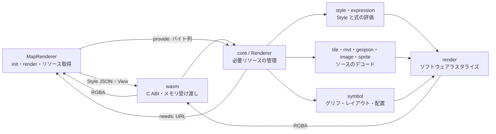

# ml2drender

MapLibre Style の **2D 表現のみ**を静止画像に描画する、Rust 製のソフトウェアレンダラです。GPU を使わず、`wasm32-unknown-unknown` でブラウザなどから実行できます。MapLibre GL JS の実装を参照し、Vibe Coding で作成しました。

対象は Web Mercator の平面地図です。`background`、`fill`、`line`、`circle`、`raster`、`symbol`、`hillshade`、`color-relief`、`heatmap` レイヤを扱います。**3D 系の表現は今後もサポートしません。** `fill-extrusion`、terrain、globe、pitch などは対象外です。実行中のスタイルやカメラの変更も対象外で、画像ごとにレンダラを作ります。

## 試す

Node.js は `.node-version`、pnpm は `package.json` の指定に合わせてください。Rust と `wasm32-unknown-unknown` ターゲットも必要です。

```sh
pnpm install
rustup target add wasm32-unknown-unknown
pnpm demo
```

`pnpm demo` は WASM をビルドして Vite の比較画面を起動します。左は MapLibre GL JS、右は本レンダラが生成した 256px ラスタータイルを Leaflet で表示します。どちらの地図を動かしても、もう一方の中心とズームが同期します。右側の Style・リソース取得と WASM 描画は Web Worker で実行し、画素データを転送してメインスレッドでタイルに表示します。デモでは取得リソースのキャッシュを無期限 TTL にし、容量上限は既定の 64 MiB を使います。テスト用の上流 fixture は `pnpm fixtures` で取得できます。

## JavaScript API

ブラウザ向けの [`MapRenderer`](src/index.ts) が、WASM のロード、リソース取得、画像生成をまとめて扱います。先に `pnpm build:wasm` を実行してください。現在のモジュールは Vite の `?url` アセット読み込みを使います。

```ts
import { MapRenderer } from './src/index';

const renderer = await MapRenderer.init('/style.json', {
  cache: { ttlMs: 300_000, maxBytes: 64 * 1024 * 1024 },
  transformFillExtrusion: (layer) => ({
    ...layer,
    type: 'fill',
    paint: { 'fill-color': '#888888' },
  }),
});
const image = await renderer.render({
  center: [139.767, 35.681], // [経度, 緯度]
  zoom: 12,
  width: 512,
  height: 512,
  pixelRatio: devicePixelRatio,
  margin: 128,
});

const canvas = document.querySelector('canvas')!;
canvas.width = image.width;
canvas.height = image.height;
canvas.getContext('2d')!.putImageData(
  new ImageData(Uint8ClampedArray.from(image.data), image.width, image.height), 0, 0,
);
```

- `MapRenderer.init(styleUrl, options?)`: Style JSON を取得し、WASM をロードします。相対 URL は現在のページを基準に解決します。
- `options.cache.ttlMs`: 取得したタイル・sprite・グリフなどをメモリに保持する期間（ミリ秒）。既定は 5 分。`0` ならキャッシュせず、`Infinity` なら期限切れになりません。期限は取得完了から計測します。
- `options.cache.maxBytes`: キャッシュするデータの合計上限（バイト）。既定は 64 MiB。上限に達すると最近使っていないデータから削除します。上限を超える単体のデータは保持しません。取得失敗はキャッシュしません。Style JSON と WASM はインスタンス内で再利用します。
- `options.transformFillExtrusion`: Style JSON にある各 `fill-extrusion` レイヤを、対応する 2D レイヤ定義へ変換する関数です。`init()` 時に適用され、元のレイヤ ID などを使って置き換えられます。返り値には対応レイヤの `type` と `id` が必要です。
- `renderer.render(view)`: 必要なタイル・画像・グリフを取得し、`Promise<RenderedImage>` を返します。同じインスタンスで異なる視点を繰り返し描画できます。
- `view`: `center: [lng, lat]`、`zoom`、`width`、`height` は必須。`bearing`（時計回りの度数、既定 0）と `pixelRatio`（既定 1）は省略できます。幅・高さは CSS ピクセル単位です。
- `view.margin`: 四辺に追加する描画余白（CSS ピクセル単位の非負整数、既定 0）。余白までタイル取得・symbol の衝突判定・描画を行い、中央の指定サイズを返します。出力サイズ・中心・ズームは変わりません。タイル境界の外側にアンカーを持つ symbol の欠落を軽減できますが、タイルごとの衝突判定の一致を保証するものではありません。余白を増やすほど取得量・描画時間・メモリ使用量も増えます。デモでは 128 を指定しています。
- `RenderedImage`: `width`、`height`、行優先の 8 bit RGBA 画素列 `data: Uint8ClampedArray` を持ちます。取得や描画の失敗は例外になります。

## アーキテクチャ



`core/` はネットワークやファイル I/O を持たない Rust ライブラリです。必要な URL を `needs()` で通知し、ホストから `provide()` で受け取ったデータを処理します。`wasm/` はこの API を C ABI として公開し、`src/index.ts` の `MapRenderer` が WASM メモリ操作と取得ループを隠します。`examples/browser/` は Web Worker 内で公開クラスを使い、生成したタイルの画素データを Leaflet に渡します。`cli/` はテストとネイティブでの検証に使います。

## 開発

```sh
pnpm test              # Rust の単体テスト
pnpm typecheck         # ブラウザサンプルの型チェック
pnpm fixtures          # 上流のテストデータを取得（初回）
pnpm test:render       # MapLibre GL JS の render テスト
pnpm test:expression   # Style Spec の式テスト
```

対応状況と既知の差分は [STATUS.md](STATUS.md) を参照してください。
