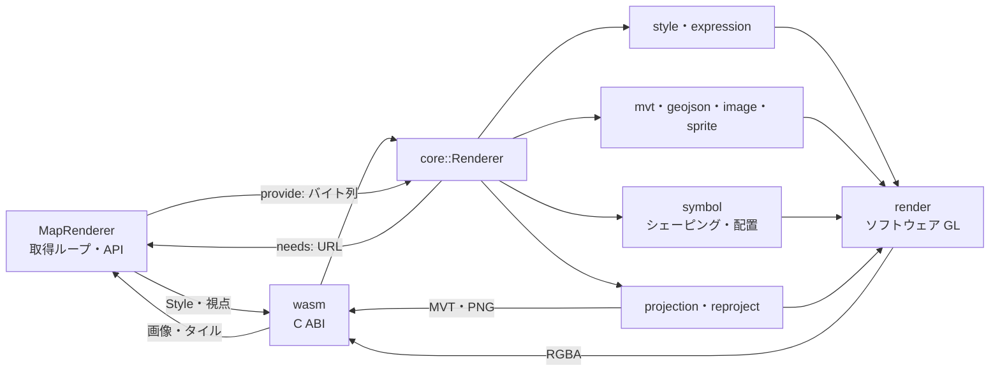

# ml2drender

**MapLibre Style を GPU なしで描く、Rust 製の 2D 地図レンダラ。** WebAssembly で、ブラウザ・Cloudflare Workers・Node.js から使えます。

[デモ](https://kanahiro.github.io/ml2drender/) · [JavaScript API](#javascript-api) · [投影座標系](#投影座標系) · [Cloudflare Workers](#cloudflare-workers)

- **GPU・ネイティブ依存なし** — 純 Rust のソフトウェアラスタライザです。`wasm32-unknown-unknown` で動き、C ライブラリに依存しません。
- **MapLibre 準拠** — MapLibre GL JS のバケット生成とシェーダの計算を移植しています。上流の render テストのうち、対象の 98.0% を GL JS と同じ許容差で通ります（[準拠状況](#準拠状況)）。
- **任意の投影座標系** — PROJJSON で指定した CRS（UTM・平面直角座標系・LAEA・極ステレオ・Equal Earth・静止衛星視など）に、地図を直接描けます。
- **GL JS で任意の CRS** — スタイルの全ソース（ベクトルタイル・GeoJSON・ラスタ・DEM）をその CRS のタイル格子に再投影して配信できます。これを使えば、MapLibre GL JS 自身が元のスタイルを任意の CRS で描けます。
- **サーバレス向き** — ネットワークやファイル I/O を持たない設計です（取得はホストが行います）。Cloudflare Workers の 128 MB の上限に収まるよう、メモリを抑えています。

> [!NOTE]
> 対象は平面の 2D 地図です。fill-extrusion・terrain・globe・pitch などの 3D 表現は扱いません（fill-extrusion は既定で fill として描きます）。また、描画中にスタイルを変更する API はありません。

MapLibre GL JS の実装を参照し、Vibe Coding で作成しました。

## クイックスタート

```ts
import { MapRenderer } from 'ml2drender';

const style = await (await fetch('https://demotiles.maplibre.org/style.json')).json();
const renderer = await MapRenderer.init(style);

const image = await renderer.renderView({ center: [139.767, 35.681], zoom: 5, width: 512, height: 512 });
const png = image.toPng(); // または image.toWebp()、生の RGBA は image.data
```

必要なタイル・TileJSON・sprite・グリフは、レンダラが判断して取得します。ブラウザ（Vite など）では同梱の WASM を自動で読み込みます。Node.js と Cloudflare Workers では、コンパイル済みの WASM を `wasm` オプションで渡してください（Node.js なら `WebAssembly.compile(readFileSync(...))`）。

### インストール

現在は npm に公開しておらず、このリポジトリの pnpm workspace パッケージ `ml2drender` として使います（`"ml2drender": "workspace:*"`）。ビルドには Node.js（`.node-version`）・pnpm（`packageManager`）・Rust と `wasm32-unknown-unknown` ターゲットが必要です。

```sh
pnpm install
rustup target add wasm32-unknown-unknown
pnpm build:wasm   # WASM をビルドして packages/ml2drender/wasm/ に置く
pnpm demo         # デモ（examples/browser）を起動
```

## 使い方

### Web Mercator の地図画像

```ts
const renderer = await MapRenderer.init(style);

await renderer.renderView({ center: [lng, lat], zoom: 12, bearing: 30, width: 800, height: 600 }); // カメラ
await renderer.renderTile({ z: 12, x: 3638, y: 1612 });                                            // XYZ タイル
await renderer.render({ bbox: [139.5, 35.5, 140, 36], size: 1024 });                               // 経緯度の範囲
```

ブラウザでは、`RenderedImage` の `data` を `ImageData` にしてそのまま canvas に描けます。

```ts
canvas.getContext('2d')!.putImageData(new ImageData(image.data, image.width, image.height), 0, 0);
```

### 投影座標系の地図画像

```ts
const utm = renderer.projected({
  name: 'EPSG:32654',
  projjson: utm54n, // EPSG:32654 の PROJJSON
  tileMatrixSet: { origin: [-2_000_000, 6_000_000], extentAtZoom0: 4_000_000 },
});

await utm.render({ bbox: [300_000, 3_900_000, 500_000, 4_100_000], width: 512, height: 512 }); // CRS の範囲
await utm.renderTile({ z: 3, x: 4, y: 2 });                                                     // CRS の格子のタイル
```

### MapLibre GL JS で任意の CRS に描かせる

ml2drender が各ソースを CRS の格子に再投影したタイルを返し、MapLibre GL JS はそれを元のスタイルで描きます。CRS の登録には、GL JS 6.15 の `addProjection`（実験的な API）を使います。地図は GL JS の WebGL で描かれるので、インタラクティブに動き、地物のクエリもできます。

```ts
// サーバ（Workers など）: ソースの再投影タイルを返す
const crs = { name: 'EPSG:32654', projjson: utm54n, tileMatrixSet };
const tile = await renderer.projected(crs).getTile({ source, z, x, y }); // MVT / PNG / terrarium PNG

// ブラウザ: CRS を GL JS に登録し、書き換えたスタイルで描く
import { addProjection, Map } from 'maplibre-gl';
import { loadProjection } from 'ml2drender';

addProjection({ name: crs.name, projection: await loadProjection(crs.projjson), tileMatrixSet: crs.tileMatrixSet });
const glStyle = renderer.projected(crs).toStyle({ tiles: (source) => `https://tiles.example.com/${source}/{z}/{x}/{y}` });
new Map({ container: 'map', style: glStyle });
```

`addProjection` に渡す投影式は `loadProjection` で作ると、ml2drender の描画と同じ式になり、位置が一致します。GeoJSON ソースを GL JS 自身に描かせる場合は、GL JS の Worker でも同じ投影式を使ってください（`loadProjectionFactory` と `setProjectionHandler`。[デモの実装](examples/browser/src/gl-projection-handler.ts)を参照）。

## JavaScript API

### `MapRenderer.init(style, options?)`

Style オブジェクト（公式の `StyleSpecification` 型）を受け取り、WASM を読み込みます。スタイルは呼び出し時点の内容をコピーして使います。リソースの URL は、スタイルに書かれたまま `loadResource` に渡ります（`glyphs` と TileJSON の `url` は絶対 URL にしてください）。

| オプション | 既定 | 説明 |
|---|---|---|
| `loadResource` | HTTP fetch | `(url) => Promise<Uint8Array \| null>`。タイル・TileJSON・sprite・グリフを取得します。`null`（HTTP 404）は欠落リソースとして描画を続け、それ以外の失敗は例外になります。同時数の制限・再試行・キャッシュはここで実装します。 |
| `wasm` | 同梱の WASM | コンパイル済みの `WebAssembly.Module`。Node.js と Cloudflare Workers では必須です。 |
| `cache.ttlMs` | `300_000` | WASM 内のレンダラ（デコード済みのタイル・ジオメトリ・グリフ）を描画をまたいで再利用する期間です。`0` は描画ごとに作り直して解放し（メモリ最小）、`Infinity` は作り直しません。 |
| `exclusive` | `false` | 同じ WASM インスタンス上の描画を1本ずつ実行します。重なった描画がそれぞれデコード済みのデータを抱えたまま待つのを防ぎます（Workers 向け）。 |
| `transformFillExtrusion` | fill に変換 | fill-extrusion レイヤを 2D のレイヤに置き換える関数です。既定では色・不透明度・パターン・平行移動を引き継いだ fill にします。 |

同じ URL を同時に要求した場合は、取得を1回にまとめます。取得したバイト列そのものはキャッシュしないので、ブラウザの HTTP キャッシュか、`loadResource` 内のキャッシュ（Workers なら Cache API など）を使ってください。

### 地図画像を返すメソッド

いずれも必要なリソースを取得し、スタイルの全レイヤを描いた `Promise<RenderedImage>` を返します。同じレンダラで、視点・メソッド・CRS を混在させて（同時にも）描画でき、取得したリソースは共有されます。

| メソッド | 描く範囲 |
|---|---|
| `renderView({ center, zoom, bearing?, width, height })` | Web Mercator のカメラ。ズームは GL JS と同じです（ズーム 0 で世界全体が 512 CSS px）。 |
| `renderTile({ z, x, y, tileSize? })` | Web Mercator の XYZ タイル（`tileSize` の既定は 256）。 |
| `render({ bbox, size })` | 経緯度の範囲 `[west, south, east, north]`。長辺が `size` px になるようにカメラを合わせます。`west > east` は反子午線をまたぐ範囲です。 |
| `projected(crs).render({ bbox, width, height })` | CRS の範囲 `[minX, minY, maxX, maxY]`（CRS の単位）。 |
| `projected(crs).renderTile({ z, x, y, tileSize? })` | CRS の格子のタイル。 |
| `projected(crs).renderView({ center, zoom, width, height })` | CRS のカメラ。`center` は経緯度、北が上です（`bearing` は使えません）。ズームは `addProjection` で登録した GL JS と同じです（ズーム 0 で格子のタイル 0/0/0 が 512 CSS px）。 |

`projected(crs)` の描画は、1 CSS px あたりの CRS 単位を EPSG:3857 の赤道と同じ縮尺とみなしたズーム（OGC のスケール分母と同じ考え方。経緯度は 360° を世界の一周とします）でスタイルを評価し、ソースのタイルを選びます。ズームは場所によらないので、同じ格子のズームのタイルどうしは境界で揃います。高緯度では同じ地上解像度の Mercator 地図より高いズームになります。

共通のオプションは2つです。

- `pixelRatio`(既定 1):出力の画素数は CSS px × `pixelRatio` です。
- `margin`(既定 0):四辺に余分に描いて切り取る CSS px です。タイルの縁の外にアンカーがある symbol の欠落を減らせます。

`RenderedImage` は次のものを持ちます。

- `width`・`height`
- `data`:行優先の RGBA を並べた `Uint8ClampedArray`
- `toPng()`・`toWebp()`:WASM 内でエンコードした可逆の PNG / WebP を返します。WebP は PNG より約3割小さくなります。

### `renderer.projected(crs)`

レンダラを書き換えず、CRS `crs` で描く `ProjectedRenderer` を返します。`crs` は MapLibre GL JS の `addProjection` に登録する CRS と同じ形です。

- `name`:GL JS での名前
- `projjson`:CRS の PROJJSON
- `tileMatrixSet`:`{ origin: [minX, maxY], extentAtZoom0 }`。タイル 0/0/0 は左上が `origin`、一辺 `extentAtZoom0` の正方形で、ズームごとに4分割します。x は東、y は南に増えます。

上の `render`・`renderTile` のほかに、GL JS に描かせるためのメソッドが2つあります。

#### `getTile({ source, z, x, y })`

地図画像ではなく、スタイルのソース1つのデータを格子のタイルに再投影し、GL JS がそのまま読める形で `Promise<Uint8Array>` として返します。スタイルのレイヤやフィルタは適用しません。元のデータは、そのタイルを 512 CSS px で描く場合のズームで取得します。

| ソース | 返すもの |
|---|---|
| vector / geojson | MVT（extent 4096、外側 128 単位まで）。全レイヤ・全地物・全属性をそのまま出力し、GeoJSON ソースはソース ID をレイヤ名にします。 |
| raster / image | 512 px の PNG。既定の paint の raster レイヤで描いたものです。image ソースもタイルになります。 |
| raster-dem | 512 px の PNG。各画素の位置の標高（元 DEM から双線形補間）を `terrarium` で符号化したものです。 |

ベクトルの再投影の詳細は次のとおりです。

- 元タイルの縁で切られたポリゴンは、属性が同じ断片どうしを結合してから投影するので、元タイルの境界で割れません。ID は断片の ID がそろうときだけ残します。
- 線は元タイルの境界で分かれたままです。
- 投影の定義域（静止衛星視の地球の裏側など）の外は除きます。線は定義域の縁で終わり、ポリゴンは縁に沿って閉じます。

#### `toStyle({ tiles })`

`init` に渡した元のスタイルを、GL JS が CRS `crs.name` の上で `getTile` のタイルから描けるように書き換えて返します。

- `tiles(sourceId)`:各ソースのタイル URL テンプレート（その CRS の格子の `{z}/{x}/{y}`）を返す関数です。
- vector / geojson ソースは vector に、raster / image は raster に、raster-dem は terrarium の raster-dem に置き換えます（いずれも 512 px タイル）。
- GeoJSON ソースのレイヤには `source-layer` を補います。
- fill-extrusion などのレイヤはそのまま残ります。video ソースのレイヤは除きます。

GL JS は、投影格子上の自分のズームでスタイルを評価します。hillshade の傾斜もタイルのズームから求めます。そのため、ズームに依存する見え方は ml2drender の描画と少し違います。

### `loadProjection(projjson, options?)` / `loadProjectionFactory(options?)`

描画と同じ Rust の投影式を返します。`forward([lng, lat])` は CRS 座標を、`inverse([x, y])` は経緯度を返し、投影できない点は NaN です。タイル範囲の計算や GL JS の `addProjection` に使います。`loadProjectionFactory` は同期版の `(projjson) => Projection` を返すので、GL JS の Worker の `setProjectionHandler` のように await できない場面で使えます。

## 投影座標系

CRS は PROJJSON（`GeographicCRS` / `ProjectedCRS`）で指定します。PROJ 文字列や WKT は受け付けません。PROJJSON は `projinfo -o PROJJSON -q EPSG:32654` などで得られます。

- **対応する投影**:経緯度、横メルカトル（UTM・平面直角座標系）、メルカトル（Web Mercator を含む）、ランベルト正角円錐、極ステレオ、ランベルト正積方位、Equal Earth、静止衛星視（geos）。任意の楕円体に対応します。単位はメートル、本初子午線はグリニッジのみです。
- **測地系変換は行いません。** スタイルの座標（WGS84）を、そのまま CRS の楕円体上の経緯度として投影します。
- **座標の順序**:CRS の軸順にかかわらず、常に東・北（経度・緯度）の順です。
- **描き方**:background・fill・line・circle・heatmap・symbol は、頂点を投影して出力に直接描きます。線幅・半径・文字の大きさなどのピクセル長は、投影後も画面上で一定です。raster・hillshade・color-relief は、Web Mercator で描いた画像をメッシュで変形します。定義域の外は透明になります。

## Cloudflare Workers

Wrangler で `ml2drender/renderer.wasm` を import すると、`WebAssembly.Module` として渡せます。

```ts
import { MapRenderer } from 'ml2drender';
import wasm from 'ml2drender/renderer.wasm';

export default {
  async fetch() {
    const style = await (await fetch('https://demotiles.maplibre.org/style.json')).json();
    const renderer = await MapRenderer.init(style, { wasm, cache: { ttlMs: 0 }, exclusive: true });
    const image = await renderer.renderView({ center: [0, 0], zoom: 0, width: 512, height: 512, margin: 64 });
    return new Response(image.toWebp(), { headers: { 'Content-Type': 'image/webp' } });
  },
};
```

isolate のメモリ上限 128 MB は、JS ヒープと WASM メモリ（縮まない）の合計にかかります。レンダラはリクエストごとに `ttlMs: 0` で作り、`exclusive: true` にしてください。こうしたレンダラは isolate 内で WASM インスタンスを共有し、同時に来たリクエストを1本ずつ描きます。OpenFreeMap Liberty で東京駅周辺の z14 を描くと、WASM メモリは約 75 MiB です（512 px・margin 64、ローカルの workerd で同時 8 リクエストでも同じ）。

## 準拠状況

[MapLibre GL JS の render テスト](https://github.com/maplibre/maplibre-gl-js/tree/main/test/integration/render)を、GL JS と同じ比較（pixelmatch、テストごとの許容差）で実行しています。

| | 件数 |
|---|---|
| render テスト（対象 1008 件） | 988 pass / 20 fail（98.0%） |
| 式テスト（Style Spec、583 件） | 581 pass / 2 fail（99.7%） |

対象外（727 件）は、3D・pitch・非 Mercator の GL 投影・実行時のスタイル変更などのテストです。主な既知の非対応は次のとおりです。

- 双方向テキスト・アラビア文字の字形整形、ブラウザフォントでのグリフ描画（TinySDF）
- 配置の履歴依存（`prevAnchor`・CrossTileSymbolIndex）。単発の静止画では再現しません。
- ロケール別の照合、`number-format` の en-US 以外

## アーキテクチャ



- `crates/core/` は、ネットワーク・ファイル・非同期・スレッド・時計に依存しない（sans-IO）Rust ライブラリです。必要な URL を `needs()` で知らせ、ホストが `provide()` で渡したデータを処理します。必要なリソースは、タイル → テキスト → グリフ範囲のように段階的に確定します。
- `crates/wasm/` は、この API を wasm-bindgen なしの C ABI で公開します。
- [`packages/ml2drender`](packages/ml2drender/src/index.ts) が、WASM のメモリ操作と取得ループを隠します。

描画は GPU パイプラインの構造は真似ず、MapLibre のバケット生成・シェーダの計算・量子化を移植し、GL と同じ規則でラスタライズします。

## 開発

```sh
pnpm test              # Rust の単体テスト
pnpm typecheck         # TypeScript の型チェック（API の型テストを含む）
pnpm fixtures          # 上流のテストデータを取得（初回のみ、約 144 MB）
pnpm test:render       # render テスト → target/test-report/render/
pnpm test:expression   # 式テスト → target/test-report/expression/
pnpm bench base=<dir> head=.   # WASM の性能比較
```

```text
crates/core/          描画エンジン（sans-IO）
crates/wasm/          C ABI
crates/cli/           テストランナー・ネイティブ検証
packages/ml2drender/  JavaScript API
examples/browser/     デモ（Vite + MapLibre GL JS）
```

設計の制約と方針は [AGENTS.md](AGENTS.md) にあります。

## ライセンス

BSD-3-Clause。MapLibre GL JS と MapLibre Style Spec の実装を参照しています。テストデータ（`pnpm fixtures`）はそれぞれのライセンスに従います。
