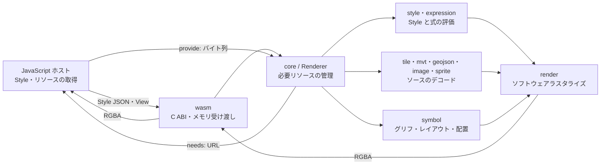

# mlrender

MapLibre Style の **2D 表現のみ**を静止画像に描画する、Rust 製のソフトウェアレンダラです。GPU を使わず、`wasm32-unknown-unknown` でブラウザなどから実行できます。MapLibre GL JS の実装を参照し、Vibe Coding で作成しました。

対象は Web Mercator の平面地図です。`background`、`fill`、`line`、`circle`、`raster`、`symbol`、`hillshade`、`color-relief`、`heatmap` レイヤを扱います。**3D 系の表現は今後もサポートしません。** `fill-extrusion`、terrain、globe、pitch などは対象外です。実行中のスタイルやカメラの変更も対象外で、画像ごとにレンダラを作ります。

## 試す

Node.js は `.node-version`、pnpm は `package.json` の指定に合わせてください。Rust と `wasm32-unknown-unknown` ターゲットも必要です。

```sh
pnpm install
rustup target add wasm32-unknown-unknown
pnpm demo
```

`pnpm demo` は WASM をビルドして Vite の比較画面を起動します。画面左に MapLibre GL JS、右に本レンダラの結果を表示します。テスト用の上流 fixture は `pnpm fixtures` で取得できます。

## JavaScript API

現在、配布用の JavaScript ラッパーはありません。`pnpm build:wasm` で生成される `target/wasm32-unknown-unknown/wasm/mlrender_wasm.wasm` を `WebAssembly.instantiate` し、以下の export を呼びます。具体的なホスト実装は [ブラウザのサンプル](examples/browser/src/main.ts)を参照してください。

| export | 引数・戻り値 | 役割 |
| --- | --- | --- |
| `alloc(len)` | バイト数 → ポインタ | 入力用の WASM メモリを確保 |
| `dealloc(ptr, len)` | ポインタ、確保時のバイト数 | 入力用メモリを解放 |
| `renderer_new(stylePtr, styleLen, lng, lat, zoom, bearing, width, height, pixelRatio)` | UTF-8 の Style JSON、中心座標、ズーム、回転角、CSS ピクセル単位の幅・高さ、画素比 → ハンドル | レンダラを作成。失敗時は `0` |
| `renderer_needs(handle)` | ハンドル → 必要な URL の数 | 取得が必要なリソースを列挙 |
| `renderer_provide(handle, urlPtr, urlLen, dataPtr, dataLen, found)` | UTF-8 URL、取得したバイト列、成功時 `1`／失敗時 `0` | リソースの結果を渡す |
| `renderer_render(handle)` | ハンドル → 成功時 `1`／失敗時 `0` | RGBA 画像を生成 |
| `renderer_free(handle)` | ハンドル | レンダラを解放 |
| `out_ptr()` / `out_len()` | ポインタ／バイト数 | 直近の結果バッファを参照 |

`renderer_new` の `lng` / `lat` は度、`bearing` は時計回りの度数です。出力サイズは `round(width * pixelRatio) × round(height * pixelRatio)` ピクセルです。画像は各画素が **RGBA 8 bit、行優先**のバイト列です。

ホストは次の順で呼びます。

1. Style JSON を取得して `renderer_new` に渡す。
2. `renderer_needs` を呼び、戻り値が 0 になるまで、返された各 URL を取得して `renderer_provide` に渡す。URL は段階的に判明するため、この往復を繰り返す。
3. `renderer_render` を呼び、結果の RGBA をコピーする。
4. 最後に `renderer_free` を呼ぶ。

`renderer_needs` の結果は `out_ptr()` / `out_len()` が示す UTF-8 バイト列で、URL を改行で区切ります。URL が相対パスなら Style JSON の URL を基準に解決します。ただし `renderer_provide` には **`renderer_needs` が返した元の URL** を渡してください。取得失敗時は `found = 0` として渡します。`renderer_new` の戻り値が `0` のとき、および `renderer_render` の戻り値が `0` のとき、出力バッファには UTF-8 のエラーメッセージが入ります。未取得のリソースが残る状態で `renderer_render` を呼ぶと失敗します。

入力は `alloc` で確保した領域へコピーし、呼び出し後に `dealloc` してください。出力バッファは**次の WASM 関数呼び出しまで**有効なので、URL 一覧・画像・エラーはすぐに JavaScript 側へコピーしてください。`renderer_free` 後のハンドルは使えません。

## アーキテクチャ



`core/` はネットワークやファイル I/O を持たない Rust ライブラリです。必要な URL を `needs()` で通知し、ホストから `provide()` で受け取ったデータを処理します。`wasm/` はこの API を薄い C ABI として公開し、`examples/browser/` が取得ループと Canvas への表示を実装しています。`cli/` はテストとネイティブでの検証に使います。

## 開発

```sh
pnpm test              # Rust の単体テスト
pnpm typecheck         # ブラウザサンプルの型チェック
pnpm fixtures          # 上流のテストデータを取得（初回）
pnpm test:render       # MapLibre GL JS の render テスト
pnpm test:expression   # Style Spec の式テスト
```

対応状況と既知の差分は [STATUS.md](STATUS.md) を参照してください。
