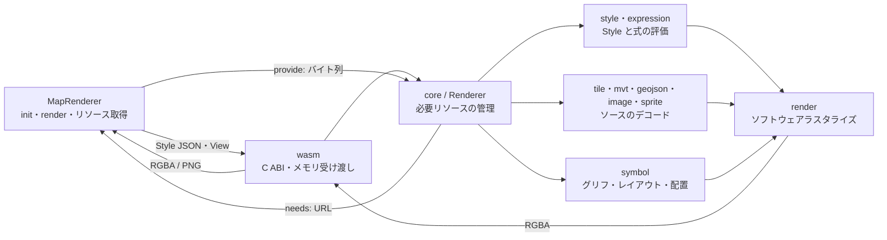

# ml2drender

MapLibre Style の **2D 表現のみ**をRGBA画像またはPNGに描画する、Rust 製のソフトウェアレンダラです。GPU を使わず、`wasm32-unknown-unknown` でブラウザやCloudflare Workersから実行できます。MapLibre GL JS の実装を参照し、Vibe Coding で作成しました。

対象は Web Mercator の平面地図です。`background`、`fill`、`line`、`circle`、`raster`、`symbol`、`hillshade`、`color-relief`、`heatmap` レイヤを扱います。`fill-extrusion` は JavaScript API で既定で `fill` に変換します。**3D 系の表現は今後もサポートしません。** 立体の描画、terrain、globe、pitch などは対象外です。実行中のスタイルやカメラの変更も対象外で、画像ごとにレンダラを作ります。

## 試す

Node.js は `.node-version`、pnpm は `package.json` の指定に合わせてください。Rust と `wasm32-unknown-unknown` ターゲットも必要です。

```sh
pnpm install
rustup target add wasm32-unknown-unknown
pnpm demo
```

`pnpm demo` は WASM をビルドして Vite の比較画面を起動します。左は MapLibre GL JS、右は本レンダラが生成した 256px ラスタータイルを MapLibre GL JS の raster ソースで表示します。どちらの地図を動かしても、もう一方の中心とズームが同期します。Style JSON は画面上で直接編集し、「適用・再描画」で両方の地図へ適用します。初期値は同梱の `examples/browser/src/style.json`（[MapLibre demotiles](https://demotiles.maplibre.org/style.json)）を使用し、Style JSON のネットワーク取得は行いません。右側のリソース取得と WASM 描画は複数の Web Worker（最大4、CPUコア数−1）で並列に実行し、Worker 内で `ImageBitmap` に変換して所有権を移譲し、メインスレッドでタイルに表示します。デモではレンダラを無期限に再利用し（`ttlMs: Infinity`）、取得はブラウザの HTTP キャッシュに任せます。テスト用の上流 fixture は `pnpm fixtures` で取得できます。

デモの統計欄には、完了タイル数と直近200タイルの生成時間（平均・p95・最大）、平均Worker往復時間、初期化時間を表示します。生成時間には素材取得を含み、往復時間には画像変換・通信・待ち時間も含みます。画面への表示時間やWASM単体のCPU時間ではありません。「再描画」は Worker 内のレンダラ（デコード済みタイル）を維持し、「適用・再描画」はスタイルとレンダラ、統計を初期化します。

## JavaScript API

[`MapRenderer`](packages/ml2drender/src/index.ts) が、WASM のロード、リソース取得、画像生成をまとめて扱います。先に `pnpm build:wasm` を実行してください。専用 `wasm` プロファイル（LTO・SIMD有効）でビルドし、成果物を公開パッケージへコピーします。ブラウザの既定ロードは `new URL(..., import.meta.url)` によるアセット参照を使い、Viteで動作します。Cloudflare Workersではコンパイル済みモジュールを渡します（後述）。

JS API は workspace パッケージ `ml2drender` として利用します。利用側の `package.json` に `"ml2drender": "workspace:*"` を追加してください。現在は TypeScript ソースを公開する非公開パッケージで、npm 配布用のビルドは用意していません。

```ts
import { MapRenderer } from 'ml2drender';

const style = await (await fetch('/style.json')).json();
const renderer = await MapRenderer.init(style, {
  cache: { ttlMs: 300_000 },
});
const image = await renderer.render({
  center: [139.767, 35.681], // [経度, 緯度]
  zoom: 12,
  width: 512,
  height: 512,
  pixelRatio: devicePixelRatio,
  margin: 64, // CSS px
});

const canvas = document.querySelector('canvas')!;
canvas.width = image.width;
canvas.height = image.height;
canvas.getContext('2d')!.putImageData(
  new ImageData(image.data, image.width, image.height), 0, 0,
);
```

- `MapRenderer.init(style, options?)`: 公式 `StyleSpecification` 型の Style オブジェクトを受け取り、WASM をロードします。Style JSON の取得（`fetch` や `fs.readFile`）は呼び出し側で行ってください。呼び出し時点の内容をコピーして使用します。スタイル内のリソース URL は書かれたまま `loadResource` に渡します。Style Spec では `glyphs` と TileJSON の `url` は絶対 URL のため、絶対 URL を使ってください（ブラウザの既定 fetch では相対 URL はページ基準で解決されます）。
- `options.loadResource`: タイル・TileJSON・sprite・glyph・既定の Wasm を取得する `(url: string) => Promise<Uint8Array<ArrayBuffer> | null>`。既定は HTTP fetch です。HTTP 404 は欠落リソース（`null`）として描画を続行します。それ以外の HTTP エラーや通信・本文読み取りの失敗は例外になります。空タイルを表す HTTP 204 は成功として扱います。Wasm は必須のため、欠落時は初期化に失敗します。ホスト側の同時数制限・再試行・タイムアウトを実装する場合に指定できます。
- `options.wasm`: コンパイル済みの `WebAssembly.Module`。指定時はWASMのfetch・実行時コンパイルを行わず、モジュールから専用インスタンスを生成します。Cloudflare Workersでは必須です。
- `options.cache.ttlMs`: WASM 内のレンダラを描画をまたいで再利用する期間（ミリ秒）。既定は 5 分。レンダラはデコード済みのタイルと線・塗りのジオメトリ（ソースごとに最近使った8タイル分）、GeoJSON・sprite・グリフなどを保持し、生成から `ttlMs` 経過後の描画で作り直します。`0` なら描画ごとに作り直し、`Infinity` なら作り直しません。密な低ズームのタイルではこの保持に数十 MiB を使うため、メモリが厳しい環境では `0` にしてください。Style と WASM はインスタンス内で再利用します。
- 取得したバイト列はキャッシュしません。同じ URL を同時に要求した場合は取得を 1 回にまとめます。再取得を避けるには、ブラウザの HTTP キャッシュに任せるか、`loadResource` 内でキャッシュしてください（Cloudflare Workers なら Cache API など）。
- `options.transformFillExtrusion`: Style JSON にある各 `fill-extrusion` レイヤを、対応する 2D レイヤ定義へ変換する関数です。省略時は `fill` に変換し、ID・metadata・source・source-layer・ズーム範囲・filter・visibility を維持します。色・不透明度・パターン・平行移動・移動の基準と、それらの式・transition を対応する fill プロパティへ引き継ぎます。高さ・底面の高さ・立体の陰影・角の丸みは反映しません。不透明度は fill のフィーチャ単位の合成に従うため、重なる地物の見え方は異なる場合があります。独自の関数を指定すると既定の変換を置き換えます。`init()` 時に適用されます。引数の `FillExtrusionLayer` は公式 [`@maplibre/maplibre-gl-style-spec`](https://github.com/maplibre/maplibre-style-spec) の `FillExtrusionLayerSpecification`、返り値の `StyleLayer` は公式 `LayerSpecification` から `fill-extrusion` を除いた型です。レイヤ種別ごとの必須項目・paint・layout を型チェックします。型定義は取得した JSON の実行時検証を行うものではありません。
- `renderer.render(view)`: 必要なタイル・画像・グリフを取得し、`Promise<RenderedImage>` を返します。同じインスタンスで異なる視点を繰り返し描画できます。
- `renderer.renderPng(view)`: 同じリソース取得・描画処理を使い、WASM内でPNG化した `Promise<Uint8Array<ArrayBuffer>>` を返します。RGBA8の可逆圧縮で、速度重視の圧縮設定です。寸法・DPR・余白切り出しは `render()` と同じです。返すバイト列は独立したコピーなので、続けて描画しても書き換わりません。
- `view`: `center: [lng, lat]`、`zoom`、`width`、`height` は必須。`bearing`（時計回りの度数、既定 0）と `pixelRatio`（既定 1）は省略できます。幅・高さは CSS ピクセル単位です。
- `view.margin`: 四辺に追加する描画余白（CSS ピクセル単位の非負整数、既定 0）。余白までタイル取得・symbol の衝突判定・描画を行い、中央の指定サイズを返します。出力サイズ・中心・ズームは変わりません。タイル境界の外側にアンカーを持つ symbol の欠落を軽減できますが、タイルごとの衝突判定の一致を保証するものではありません。余白を増やすほど取得量・描画時間・メモリ使用量も増えます。デモでは `64` CSS ピクセルを指定しています。大きな symbol には、より広い余白が必要になる場合があります。
- `RenderedImage`: `width`、`height`、行優先の 8 bit RGBA 画素列 `data: Uint8ClampedArray` を持ちます。取得や描画の失敗は例外になります。

## Cloudflare Workers

Wranglerで `ml2drender/renderer.wasm` をimportすると `WebAssembly.Module` として渡せます。`?url` や実行時コンパイルは不要です（[Cloudflare公式ドキュメント](https://developers.cloudflare.com/workers/runtime-apis/webassembly/javascript/)）。`.wasm` 拡張子を含むこの公開パスを使ってください。

```ts
import { MapRenderer } from 'ml2drender';
import wasm from 'ml2drender/renderer.wasm';

export default {
  async fetch() {
    const style = await (await fetch('https://demotiles.maplibre.org/style.json')).json();
    const renderer = await MapRenderer.init(style, { wasm });
    const png = await renderer.renderPng({
      center: [0, 0], zoom: 0, width: 512, height: 512, margin: 64,
    });
    return new Response(png, { headers: { 'Content-Type': 'image/png' } });
  },
};
```

ブラウザのWeb Workerとは別のランタイムです。画像配信ではBitmap化せず、PNGバイト列をHTTPレスポンスにします。コンパイル済みモジュールだけを共有し、リソース取得はリクエスト内で行い、レンダラとWASMメモリはリクエストごとに生成してください。

## アーキテクチャ



`crates/core/` はネットワークやファイル I/O を持たない Rust ライブラリです。必要な URL を `needs()` で通知し、ホストから `provide()` で受け取ったデータを処理します。`crates/wasm/` はこの API を C ABI として公開し、`packages/ml2drender/src/index.ts` の `MapRenderer` が WASM メモリ操作と取得ループを隠します。`examples/browser/` は Web Worker 内で公開クラスを使い、生成したタイルの画素データを Worker 内で `ImageBitmap` に変換します。その所有権をメインスレッドへ移譲し、`addProtocol` 経由で MapLibre GL JS の raster ソースに渡します。`crates/cli/` はテストとネイティブでの検証に使います。

## 開発

Cargo と pnpm の workspace をルートで管理します。Rust の crate は `crates/`、TypeScript のライブラリは `packages/`、利用例は `examples/` に置きます。

```text
.
├── Cargo.toml / Cargo.lock         # Rust workspace
├── package.json / pnpm-workspace.yaml / pnpm-lock.yaml
├── crates/
│   ├── core/                      # I/O を持たない描画エンジン
│   ├── wasm/                      # C ABI
│   └── cli/
│       ├── src/                   # ネイティブ実行・上流テストランナー
│       └── tests/exclusions.json  # render テストの除外ルール
├── packages/ml2drender/
│   ├── src/                       # MapRenderer と公開型
│   ├── tests/                     # API の型テスト
│   ├── package.json / tsconfig.json
│   └── wasm/                      # build:wasm で配置する生成物（gitignore）
├── examples/browser/              # パッケージ名で API を使う Vite デモ
├── scripts/                       # リポジトリ全体の開発スクリプト
├── fixtures/                      # 上流テストデータ（gitignore）
└── target/                        # Cargo の生成物・テストレポート（gitignore）
```

テストや設定は所有するパッケージに置き、ルートには全体を管理するものを置きます。`pnpm build:wasm` は Cargo の出力を JS パッケージ内にコピーするため、利用側が Rust の生成物のパスを知る必要はありません。

```sh
pnpm test              # Rust の単体テスト
pnpm typecheck         # JavaScript API・型の回帰テスト・ブラウザサンプルの型チェック
pnpm fixtures          # 上流のテストデータを取得（初回）
pnpm test:render       # MapLibre GL JS の render テスト
pnpm test:expression   # Style Spec の式テスト
```

対応状況と既知の差分は [STATUS.md](STATUS.md) を参照してください。
