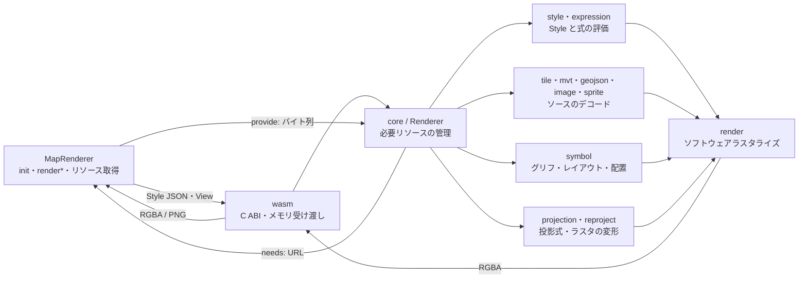

# ml2drender

MapLibre Style の **2D 表現のみ**をRGBA画像またはPNGに描画する、Rust 製のソフトウェアレンダラです。GPU を使わず、`wasm32-unknown-unknown` でブラウザやCloudflare Workersから実行できます。MapLibre GL JS の実装を参照し、Vibe Coding で作成しました。

対象は平面地図です。Web Mercator のカメラ（中心・ズーム・回転）に加え、PROJJSON で指定した投影座標系の範囲（bbox）を描画できます（[投影座標系](#投影座標系)）。`background`、`fill`、`line`、`circle`、`raster`、`symbol`、`hillshade`、`color-relief`、`heatmap` レイヤを扱います。`fill-extrusion` は JavaScript API で既定で `fill` に変換します。**3D 系の表現は今後もサポートしません。** 立体の描画、terrain、globe、pitch などは対象外です。実行中のスタイルの変更も対象外です。

## 試す

Node.js は `.node-version`、pnpm は `package.json` の指定に合わせてください。Rust と `wasm32-unknown-unknown` ターゲットも必要です。

```sh
pnpm install
rustup target add wasm32-unknown-unknown
pnpm demo
```

`pnpm demo` は WASM をビルドして Vite のデモ画面を起動します。地図ペイン右上の切り替えで、本レンダラが生成した 256px ラスタータイルを MapLibre GL JS の raster ソースで表示するか、`renderProjectedMvt` で再投影したベクトルタイルを GL JS 自身にスタイルどおり描かせるかを選べます。ベクトルではスタイルの vector / GeoJSON ソースのレイヤだけを描き（raster などのレイヤは表示しません）、地物にマウスを重ねるとレイヤ名・ソースレイヤ・ID・属性を表示します。左の Style JSON・PROJJSON・GeoJSON の入力欄が描画の設定で、入力が止まると（500ms のデバウンス）自動で反映します。各欄は見出しで開閉でき、閉じているときはプルダウンだけ、開くと直接入力できます。それぞれのプルダウンで入力欄をプリセット（スタイル: MapLibre デモタイル・経緯線付き・地理院タイル・OpenFreeMap Liberty、投影: 経緯度・Equal Earth・平面直角座標系・UTM・Lambert-93・LAEA Europe・極ステレオ・ひまわり Full Disk など）に書き換えて再描画します。PROJJSON が空欄なら Web Mercator を再投影なしで描きます。PROJJSON を指定すると、`loadProjection` の投影式と、PROJJSON の `bbox`（適用範囲、なければ全球）を投影した正方形のタイル格子で GL JS の `addProjection` に登録し、各タイルを `renderProjected`（PROJJSON が空欄なら `renderZxy`）で描きます。整合確認用に GeoJSON 欄の内容（既定は Natural Earth の都市）を GL JS 自身が重ね、ホバーで属性を表示します。GL JS は GeoJSON を Worker でタイル化するので、`importScriptInWorkers` で `loadProjectionFactory` を使う `setProjectionHandler` を Worker に読み込みます。表示位置は URL ハッシュ（`#zoom/lat/lng`）に残り、投影を切り替えても同じ場所・ほぼ同じ縮尺を保ちます。リソース取得と WASM 描画は複数の Web Worker（最大4、CPUコア数−1）で並列に実行し、Worker 内で `ImageBitmap` に変換して所有権を移譲し、メインスレッドでタイルに表示します。デモではレンダラを無期限に再利用し（`ttlMs: Infinity`）、取得はブラウザの HTTP キャッシュに任せます。テスト用の上流 fixture は `pnpm fixtures` で取得できます。

デモの統計欄には、完了タイル数と直近200タイルの生成時間（平均・p95・最大）、平均Worker往復時間、初期化時間を表示します。生成時間には素材取得を含み、往復時間には画像変換・通信・待ち時間も含みます。画面への表示時間やWASM単体のCPU時間ではありません。Style JSON が変わるとスタイルとレンダラ、統計を初期化し、PROJJSON だけの変更では Worker 内のレンダラ（デコード済みタイル）を維持します。

## JavaScript API

[`MapRenderer`](packages/ml2drender/src/index.ts) が、WASM のロード、リソース取得、画像生成をまとめて扱います。先に `pnpm build:wasm` を実行してください。専用 `wasm` プロファイル（LTO・SIMD有効）でビルドし、成果物を公開パッケージへコピーします。ブラウザの既定ロードは `new URL(..., import.meta.url)` によるアセット参照を使い、Viteで動作します。Cloudflare Workersではコンパイル済みモジュールを渡します（後述）。

JS API は workspace パッケージ `ml2drender` として利用します。利用側の `package.json` に `"ml2drender": "workspace:*"` を追加してください。現在は TypeScript ソースを公開する非公開パッケージで、npm 配布用のビルドは用意していません。

```ts
import { MapRenderer } from 'ml2drender';

const style = await (await fetch('/style.json')).json();
const renderer = await MapRenderer.init(style, {
  cache: { ttlMs: 300_000 },
});
const image = await renderer.renderView({
  center: [139.767, 35.681], // [経度, 緯度]
  zoom: 12,
  width: 512,
  height: 512,
  pixelRatio: devicePixelRatio,
  margin: 64, // CSS px
});

const canvas = document.querySelector('canvas')!;
canvas.width = image.width;
canvas.height = image.height;
canvas.getContext('2d')!.putImageData(
  new ImageData(image.data, image.width, image.height), 0, 0,
);
```

- `MapRenderer.init(style, options?)`: 公式 `StyleSpecification` 型の Style オブジェクトを受け取り、WASM をロードします。Style JSON の取得（`fetch` や `fs.readFile`）は呼び出し側で行ってください。呼び出し時点の内容をコピーして使用します。スタイル内のリソース URL は書かれたまま `loadResource` に渡します。Style Spec では `glyphs` と TileJSON の `url` は絶対 URL のため、絶対 URL を使ってください（ブラウザの既定 fetch では相対 URL はページ基準で解決されます）。
- `options.loadResource`: タイル・TileJSON・sprite・glyph を取得する `(url: string) => Promise<Uint8Array<ArrayBuffer> | null>`。既定は HTTP fetch です。HTTP 404 は欠落リソース（`null`）として描画を続行します。それ以外の HTTP エラーや通信・本文読み取りの失敗は例外になります。空タイルを表す HTTP 204 は成功として扱います。同梱の Wasm（`wasm` 未指定時）はこれを使わず HTTP fetch で取得し、一度だけコンパイルします。ホスト側の同時数制限・再試行・タイムアウトを実装する場合に指定できます。
- `options.wasm`: コンパイル済みの `WebAssembly.Module`。指定時はWASMのfetch・実行時コンパイルを行いません。Cloudflare Workersでは必須です。`cache.ttlMs` が `0` のレンダラと `loadProjection` は、モジュールごとに1つの WASM インスタンスを共有します（WASM のメモリは縮まないため、ある描画が解放したメモリを次の描画が再利用します）。リソースを保持するレンダラは専用のインスタンスを持ち、レンダラとともに回収されます。
- `options.cache.ttlMs`: WASM 内のレンダラを描画をまたいで再利用する期間（ミリ秒）。既定は 5 分。レンダラはデコード済みのタイルと線・塗りのジオメトリ（ソースごとに最近使った8タイル分）、GeoJSON・sprite・グリフなどを保持し、生成から `ttlMs` 経過後の描画で作り直します。`0` なら描画ごとに作り直し（描画が終わると解放し、描画中も各レイヤの線・塗りのジオメトリを描き終えた時点で捨てます）、`Infinity` なら作り直しません。密なタイルではこの保持に数十 MiB を使うため、メモリが厳しい環境では `0` にしてください。Style はインスタンス内で再利用します。
- `options.exclusive`: `true` なら、同じ WASM インスタンス上の他の `exclusive` な描画と1本ずつ順に実行します（最初の取得から画像まで）。重なって走る描画は取得を待つあいだもそれぞれのデコード済みリソースを保持するため、WASM メモリが本数に比例して増えます。`exclusive` なら最大の1枚分で済みます。既定は `false`。
- 取得したバイト列はキャッシュしません。同じ URL を同時に要求した場合は取得を 1 回にまとめます。同じインスタンスで重なって走る描画は、互いにまだ描いていないタイルを WASM 内のキャッシュから追い出しません。再取得を避けるには、ブラウザの HTTP キャッシュに任せるか、`loadResource` 内でキャッシュしてください（Cloudflare Workers なら Cache API など）。
- `options.transformFillExtrusion`: Style JSON にある各 `fill-extrusion` レイヤを、対応する 2D レイヤ定義へ変換する関数です。省略時は `fill` に変換し、ID・metadata・source・source-layer・ズーム範囲・filter・visibility を維持します。色・不透明度・パターン・平行移動・移動の基準と、それらの式・transition を対応する fill プロパティへ引き継ぎます。高さ・底面の高さ・立体の陰影・角の丸みは反映しません。不透明度は fill のフィーチャ単位の合成に従うため、重なる地物の見え方は異なる場合があります。独自の関数を指定すると既定の変換を置き換えます。`init()` 時に適用されます。引数の `FillExtrusionLayer` は公式 [`@maplibre/maplibre-gl-style-spec`](https://github.com/maplibre/maplibre-style-spec) の `FillExtrusionLayerSpecification`、返り値の `StyleLayer` は公式 `LayerSpecification` から `fill-extrusion` を除いた型です。レイヤ種別ごとの必須項目・paint・layout を型チェックします。型定義は取得した JSON の実行時検証を行うものではありません。
- 描画メソッドは 4 つあり、いずれも必要なタイル・画像・グリフを取得して `Promise<RenderedImage>` を返します。同じインスタンスで、異なる視点やメソッドを混在させて繰り返し描画できます。`renderView`・`renderZxy`・`renderLngLat` は Web Mercator で描き、`renderProjected` だけが投影座標系で描きます。
  - `renderer.renderView(view)`: Web Mercator のカメラ。`view.center: [lng, lat]`、`zoom`、`width`、`height` は必須で、`bearing`（時計回りの度数、既定 0）は省略できます。幅・高さは CSS ピクセル単位、ズームは MapLibre GL JS と同じ（ズーム 0 で世界全体が 512 CSS ピクセル）です。
  - `renderer.renderZxy(tile)`: Web Mercator の XYZ タイル。`tile.z`・`x`・`y`（整数）は必須で、`tileSize`（CSS ピクセル、既定 256）は省略できます。出力は `tileSize` 四方です。
  - `renderer.renderLngLat(view)`: 経緯度の範囲。`view.bbox: [west, south, east, north]`（度）と `size`（長辺の CSS ピクセル数、正の整数）は必須です。出力は範囲の（Web Mercator 上の）縦横比で長辺が `size`、短辺はそれに合わせて四捨五入した大きさになり、範囲がちょうど収まるズーム（小数）を自動で選びます。`west > east` は反子午線をまたぐ範囲、緯度は ±85.0511° に丸めます。
  - `renderer.renderProjected(view)`: 投影座標系の範囲。`view.projjson`（PROJJSON オブジェクト）、`bbox: [minX, minY, maxX, maxY]`（CRS の単位、経緯度なら度）、`width`、`height` は必須です。bbox は出力の幅・高さにそのまま割り当てるので、縦横比を揃えてください。回転には対応していません。非対応の CRS は例外になります（[投影座標系](#投影座標系)）。
- `renderer.renderProjectedMvt(tile)`: 画像ではなく、投影座標系のタイル格子の 1 タイルを再投影したベクトルタイル（MVT、extent 4096）として `Promise<Uint8Array>` で返します。`tile.projjson`（PROJJSON オブジェクト）、`tileMatrixSet`、`z`・`x`・`y`（整数）、スタイルの vector / GeoJSON ソースの ID `source` は必須です。`tileMatrixSet` は MapLibre GL JS の `addProjection` と同じ `{ origin: [minX, maxY], extentAtZoom0 }` で、タイル 0/0/0 は左上が `origin`・一辺 `extentAtZoom0` の正方形、ズームごとに 4 分割し、x は東、y は南に増えます。`tileSize`（CSS ピクセル、既定 512 = GL JS のベクトルタイル）はそのタイルを描く大きさで、元ソースのズームを決めます。スタイルのレイヤやフィルタに関係なく、ソースのレイヤ・地物・属性をそのまま出力します（GeoJSON ソースはソース ID のレイヤ名、null の属性は省き、配列・オブジェクトは JSON 文字列）。元タイルの境界で切られたポリゴンは、属性が同じ断片どうしを結合してから投影するので、境界で割れません（つながった部分ごとに 1 地物で、ID は断片の ID がそろうときだけ残します。接する同じ属性のポリゴンは一つになります）。線は元タイルの境界で分かれます。投影の定義域（静止衛星の見えない側など）から外れる部分は除き、線は定義域の縁で終わり、ポリゴンは縁に沿って閉じます。出力タイルの外側 128 単位で切り取ります。
- `pixelRatio`: `renderProjectedMvt` 以外の全メソッド共通。出力の画素数は CSS ピクセル × `pixelRatio`（既定 1）です。
- `margin`: 四辺に追加する描画余白（CSS ピクセル単位の非負整数、既定 0）。余白までタイル取得・symbol の衝突判定・描画を行い、中央の指定サイズを返します。出力サイズ・中心・ズームは変わりません。タイル境界の外側にアンカーを持つ symbol の欠落を軽減できますが、タイルごとの衝突判定の一致を保証するものではありません。余白を増やすほど取得量・描画時間・メモリ使用量も増えます。デモでは `64` CSS ピクセルを指定しています。大きな symbol には、より広い余白が必要になる場合があります。
- `RenderedImage`: `width`、`height`、行優先の 8 bit RGBA 画素列 `data: Uint8ClampedArray` を持ちます。取得や描画の失敗は例外になります。
- `image.toPng()`: `data` を WASM 内で PNG 化した `Uint8Array<ArrayBuffer>` を返します（同期）。RGBA8の可逆圧縮で、速度重視の圧縮設定です。返すバイト列は独立したコピーなので、続けて描画しても書き換わりません。
- `image.toWebp()`: 同様に可逆（VP8L）WebP を返します。地図画像では PNG より小さくなります（bright スタイル 512×512 で約 3 割減）。非可逆 WebP には対応していません。
- `loadProjection(projjson, options?)`: PROJJSON オブジェクトを受け取り、`renderProjected` と同じ解釈・同じ Rust の投影式を `Promise<Projection>` で返します。`projection.forward([lng, lat])` は CRS 座標（投影できない点は NaN）、`projection.inverse([x, y])` は経緯度（範囲外は NaN）を返します。タイル範囲の計算や、MapLibre GL JS の `addProjection` への登録に使うと、描画と位置が一致します。`options` は `wasm` を受け付け、WASM インスタンスはモジュールごとに共有します。
- `loadProjectionFactory(options?)`: WASM を読み込んだうえで、同期版の `loadProjection`（`(projjson) => Projection`）を返します。GL JS の Worker で `setProjectionHandler` に渡すなど、await できない場面向けです。

## 投影座標系

`renderProjected` で、PROJJSON で指定した CRS の範囲を描画できます。CRS の指定は PROJJSON だけで、PROJ 文字列や WKT は受け付けません。PROJJSON は PROJ の `projinfo -o PROJJSON -q EPSG:32654` などで得られます。

```ts
const image = await renderer.renderProjected({
  projjson: utm54n, // EPSG:32654 の PROJJSON オブジェクト
  bbox: [300_000, 3_900_000, 500_000, 4_100_000], // [minX, minY, maxX, maxY]
  width: 512,
  height: 512,
});
```

- 対応する投影: 経緯度、横メルカトル（UTM を含む）、メルカトル（Web Mercator を含む）、ランベルト正角円錐、極ステレオ、ランベルト正積方位、Equal Earth、静止衛星視（geos）。PROJJSON は `GeographicCRS` と `ProjectedCRS` を受け付け、楕円体は `semi_major_axis` と `inverse_flattening`/`semi_minor_axis`、または `radius` から読みます。単位はメートル、本初子午線はグリニッジのみです。
- 測地系変換は行いません。スタイルの座標（WGS84）をそのまま CRS の楕円体上の経緯度として投影します。変換を含む `BoundCRS` などは例外になります。
- 座標は CRS の軸順にかかわらず常に東・北（経度・緯度）の順です。EPSG:4326 でも `[minLng, minLat, maxLng, maxLat]` で指定します。
- ベクタ由来のレイヤ（`background`・`fill`・`line`・`circle`・`heatmap`・`symbol`）は頂点を投影して出力画像に直接描きます。線幅・円の半径・文字の大きさなどのピクセル長は投影後も画面上で一定です。`*-pattern` は CRS 座標に固定した原点から画面ピクセル上に一様に敷き、破線と `line-pattern` は投影後の線に沿った距離で敷きます。投影の反子午線をまたぐタイルは分けて描きます。
- `raster`・`hillshade`・`color-relief` は Web Mercator で描いた画像をメッシュで変形します。
- 投影の定義域外（静止衛星視の地球の裏側など）は透明になります。

## Cloudflare Workers

Wranglerで `ml2drender/renderer.wasm` をimportすると `WebAssembly.Module` として渡せます。`?url` や実行時コンパイルは不要です（[Cloudflare公式ドキュメント](https://developers.cloudflare.com/workers/runtime-apis/webassembly/javascript/)）。`.wasm` 拡張子を含むこの公開パスを使ってください。

```ts
import { MapRenderer } from 'ml2drender';
import wasm from 'ml2drender/renderer.wasm';

export default {
  async fetch() {
    const style = await (await fetch('https://demotiles.maplibre.org/style.json')).json();
    const renderer = await MapRenderer.init(style, { wasm, cache: { ttlMs: 0 }, exclusive: true });
    const image = await renderer.renderView({
      center: [0, 0], zoom: 0, width: 512, height: 512, margin: 64,
    });
    return new Response(image.toWebp(), { headers: { 'Content-Type': 'image/webp' } });
  },
};
```

ブラウザのWeb Workerとは別のランタイムです。画像配信ではBitmap化せず、エンコードしたバイト列をHTTPレスポンスにします。`toWebp()`（可逆）は `toPng()` より小さくなります。リソース取得はリクエスト内で行います。

isolate のメモリ上限は 128MB で、JS ヒープと WASM メモリ（縮まない）の合計です。レンダラはリクエストごとに `ttlMs: 0` で生成し、`exclusive: true` を指定してください。これらのレンダラは isolate 内で WASM インスタンスを共有し、同時に来たリクエストの描画は1本ずつ実行されます。OpenFreeMap Liberty で東京駅周辺の z14（512px、margin 64、データタイル 9 枚・グリフ範囲 152 本）の WASM メモリは約 75 MiB です（ローカルの workerd で同時 8 リクエストでも同じ）。

## アーキテクチャ



`crates/core/` はネットワークやファイル I/O を持たない Rust ライブラリです。必要な URL を `needs()` で通知し、ホストから `provide()` で受け取ったデータを処理します。視点は `set_view`（Web Mercator）か `set_projected_view`（投影座標系）で切り替え、取得済みのリソースとタイル単位のジオメトリを再利用します。`crates/wasm/` はこの API と投影式（`projection_*`）を C ABI として公開し、`packages/ml2drender/src/index.ts` の `MapRenderer` と `loadProjection` が WASM メモリ操作と取得ループを隠します。`examples/browser/` は Web Worker 内で公開クラスを使い、生成したタイルの画素データを Worker 内で `ImageBitmap` に変換します。その所有権をメインスレッドへ移譲し、`addProtocol` 経由で MapLibre GL JS の raster ソースに渡します。`crates/cli/` はテストとネイティブでの検証に使います。

## 開発

Cargo と pnpm の workspace をルートで管理します。Rust の crate は `crates/`、TypeScript のライブラリは `packages/`、利用例は `examples/` に置きます。

```text
.
├── Cargo.toml / Cargo.lock         # Rust workspace
├── package.json / pnpm-workspace.yaml / pnpm-lock.yaml
├── crates/
│   ├── core/                      # I/O を持たない描画エンジン
│   ├── wasm/                      # C ABI
│   └── cli/
│       ├── src/                   # ネイティブ実行・上流テストランナー
│       └── tests/exclusions.json  # render テストの除外ルール
├── packages/ml2drender/
│   ├── src/                       # MapRenderer と公開型
│   ├── tests/                     # API の型テスト
│   ├── package.json / tsconfig.json
│   └── wasm/                      # build:wasm で配置する生成物（gitignore）
├── examples/browser/              # パッケージ名で API を使う Vite デモ
├── scripts/                       # リポジトリ全体の開発スクリプト
├── fixtures/                      # 上流テストデータ（gitignore）
└── target/                        # Cargo の生成物・テストレポート（gitignore）
```

テストや設定は所有するパッケージに置き、ルートには全体を管理するものを置きます。`pnpm build:wasm` は Cargo の出力を JS パッケージ内にコピーするため、利用側が Rust の生成物のパスを知る必要はありません。

```sh
pnpm test              # Rust の単体テスト
pnpm typecheck         # JavaScript API・型の回帰テスト・ブラウザサンプルの型チェック
pnpm fixtures          # 上流のテストデータを取得（初回）
pnpm test:render       # MapLibre GL JS の render テスト
pnpm test:expression   # Style Spec の式テスト
```

設計方針と既知の非対応は [AGENTS.md](AGENTS.md) を参照してください。
